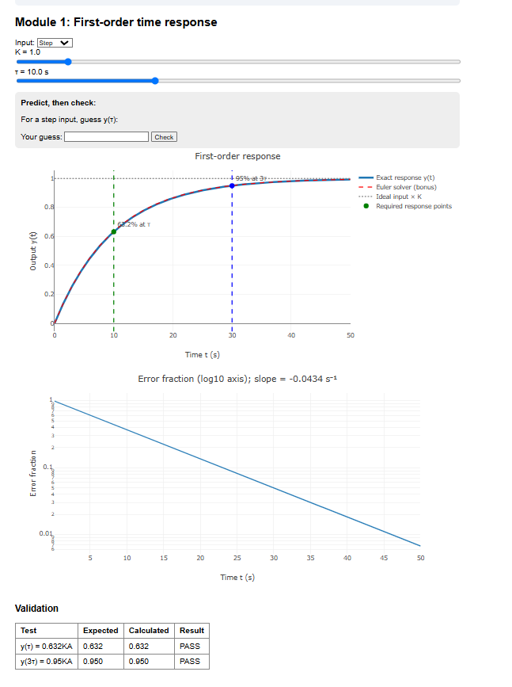
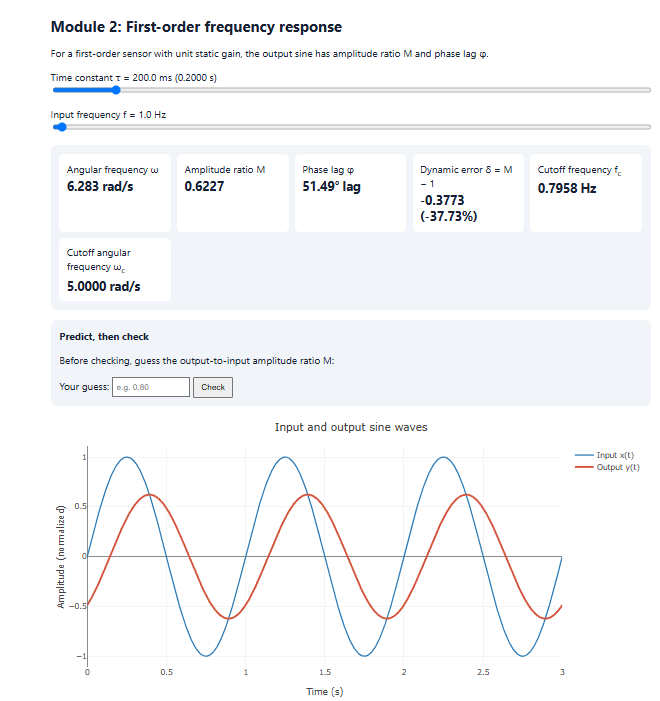
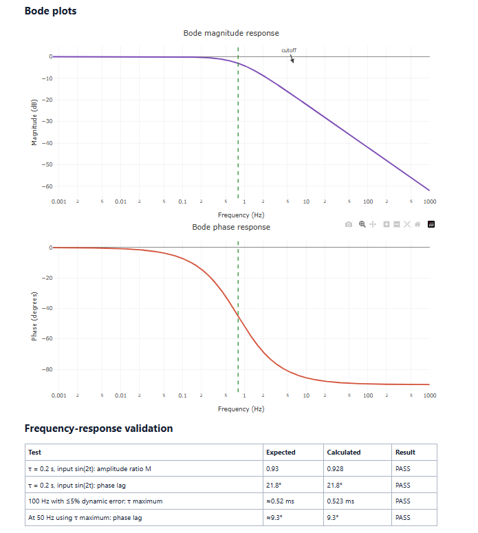
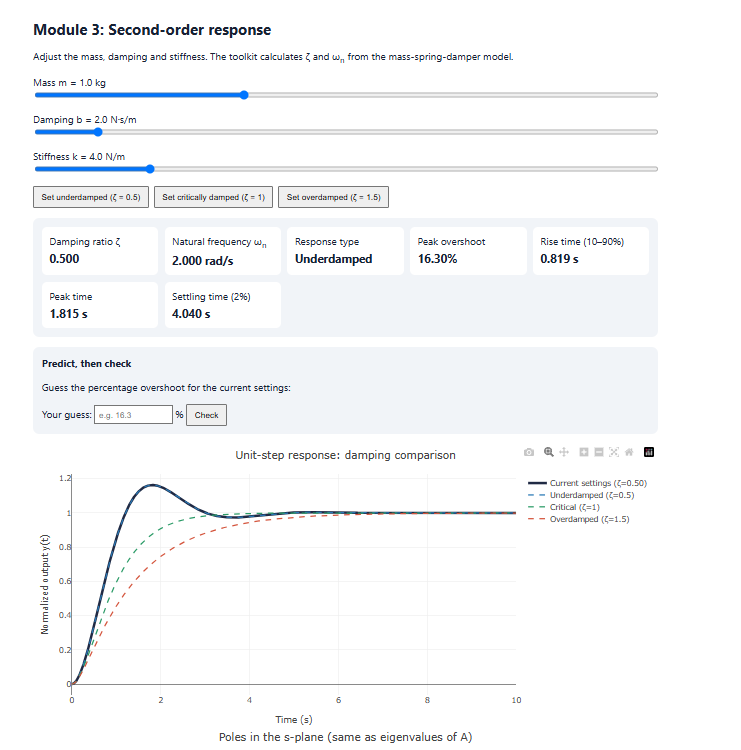
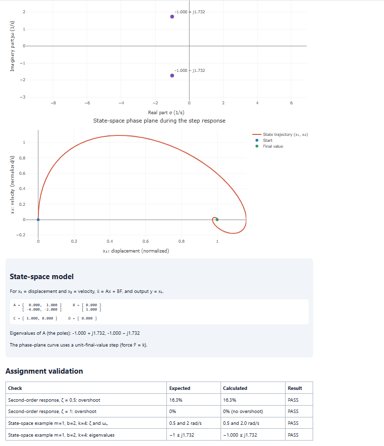
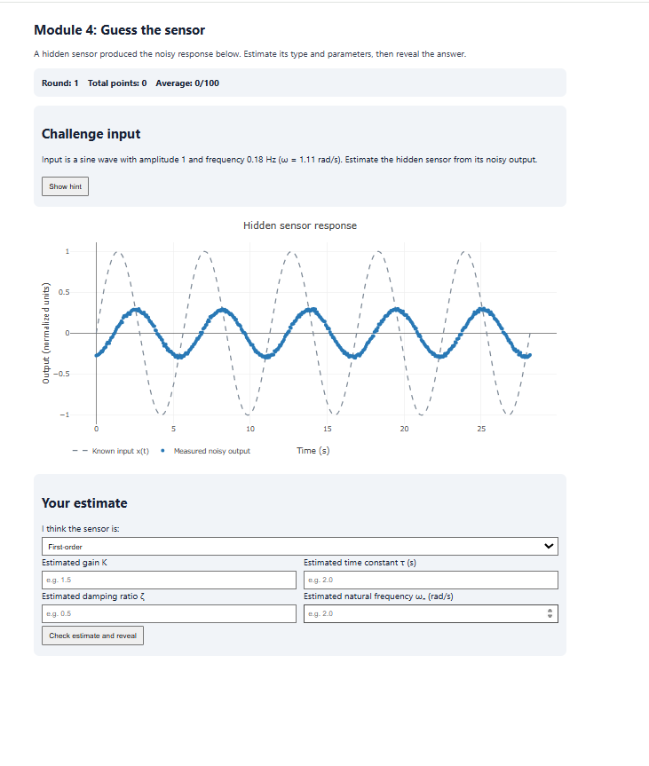

# Dynamic Characteristics Interactive Toolkit

An interactive web toolkit for exploring the dynamic response of sensors. This project was developed for **ENCS4380 – Interfacing Techniques** at Birzeit University.

**Live site:** [Open the toolkit](https://sadeenmohaddad.github.io/encs4380-dynamic-Orion-/)

**Group:** ENCS4380-T13-Orion

## Team

| Team member | GitHub username |
|---|---|
| Sadeen Haddad | `sadeenMoHaddad` |
| Bisan Ayayda | `bisanayaydah-sys` |
| Makram Sawaftah | `1230548-a11y` |
| Haitham Khalifa | `hathaimkhalifa-sys` |

## Module responsibilities

| Module | Topic | Owner |
|---|---|---|
| Module 1 | First-order time response | Sadeen Haddad |
| Module 2 | First-order frequency response | Haitham Khalifa |
| Module 3 | Second-order response and state-space model | Bisan Ayayda |
| Module 4 | Guess the sensor challenge | Makram Sawaftah |

## Modules

- **Module 1 – First-order time response:** Explore step and ramp inputs by changing gain \(K\) and time constant \(\tau\). The page plots the response, marks the key step-response points, shows ramp lag and steady-state error, and compares the exact response with an Euler solver.
- **Module 2 – First-order frequency response:** Explore how time constant and input frequency affect amplitude ratio, phase lag, Bode plots, cutoff frequency, and dynamic error.
- **Module 3 – Second-order response:** Explore underdamped, critically damped, and overdamped responses. The page displays response metrics, pole locations, and the mass-spring-damper state-space model.
- **Module 4 – Guess the sensor:** Estimate the parameters of a hidden noisy sensor, reveal the true response, compare curves, and keep a session score.

## Validation checks

The toolkit includes checks for:

1. First-order step response: \(y(\tau)=0.632KA\) and \(y(3\tau)=0.95KA\).
2. For \(\tau=0.2\text{ s}\) and input \(\sin(2t)\): amplitude ratio approximately 0.93 and phase lag approximately \(21.8^\circ\).
3. For signals up to 100 Hz with no more than 5% dynamic error: \(\tau_{\max}\approx0.52\text{ ms}\), with phase lag approximately \(9.3^\circ\) at 50 Hz.
4. Second-order response with \(\zeta=0.5\): overshoot approximately 16.3%.
5. Second-order response with \(\zeta=1\): no overshoot.
6. State-space example with \(m=1\), \(b=2\), and \(k=4\): eigenvalues \(-1\pm j1.732\), equal to the system poles.

## Screenshots

Click an image to open it.

### Module 1

### Module 2

### Module 3

### Module 4

## Run the project locally

Open `index.html` in a web browser. An internet connection is needed to load the Plotly.js library from its CDN.

## AI usage
