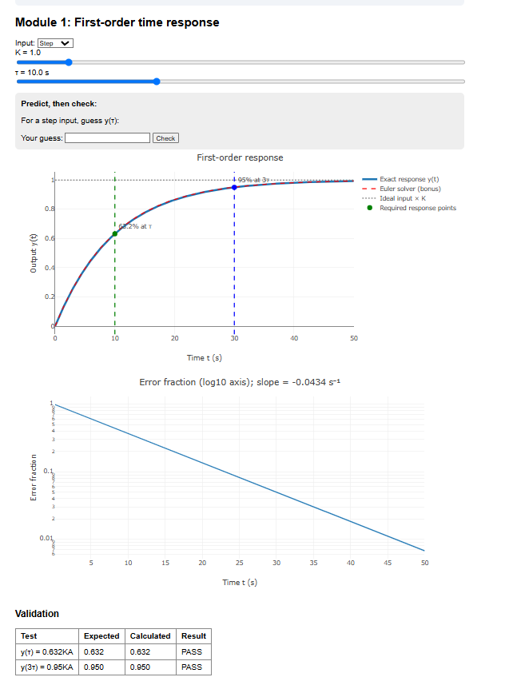
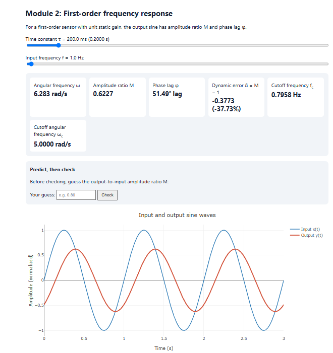
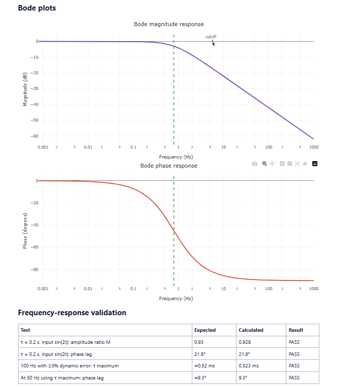
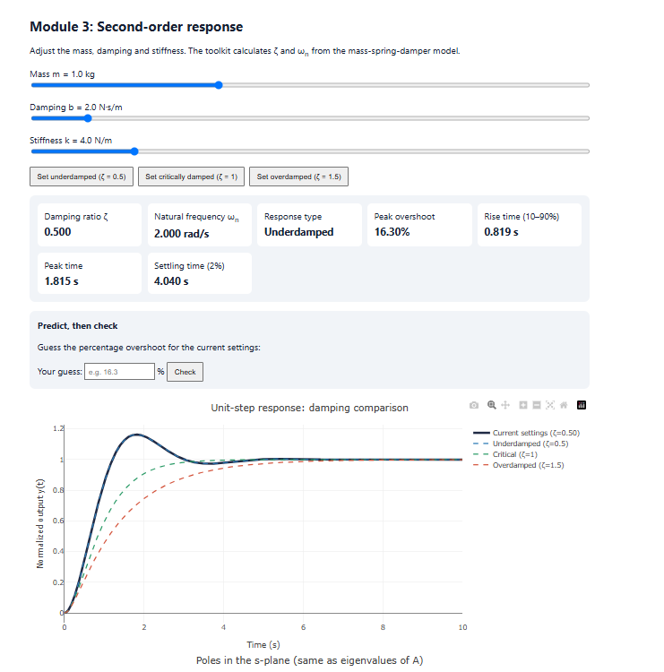
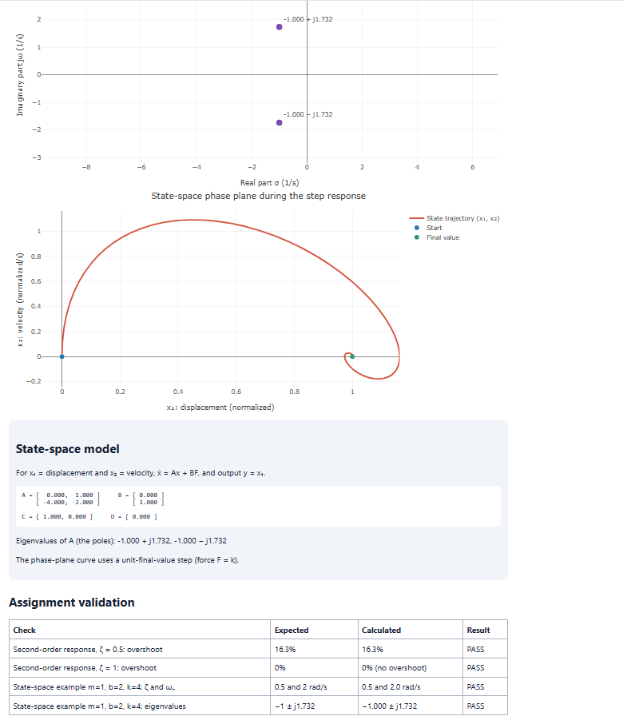
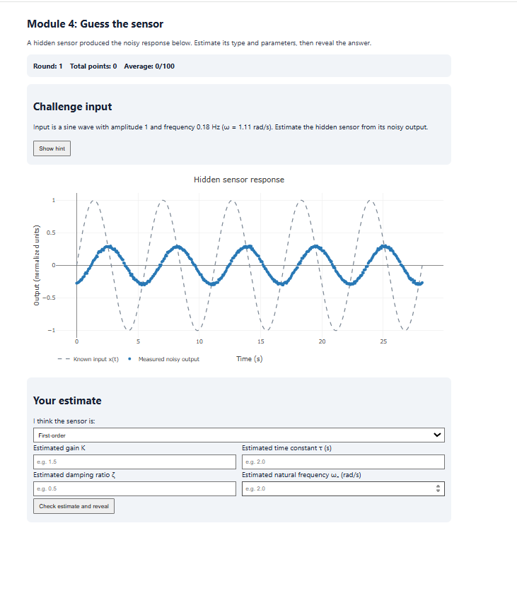

# Dynamic Characteristics Interactive Toolkit

An interactive web toolkit for exploring the dynamic response of sensors (Homework 1) and PID feedback control (Homework 2). This project was developed for **ENCS4380 – Interfacing Techniques** at Birzeit University.

**Live site:** [Open the toolkit](https://sadeenmohaddad.github.io/encs4380-dynamic-Orion-/)

**Group:** ENCS4380-T13-Orion

## Team

| Team member | GitHub username |
|---|---|
| Sadeen Haddad | `sadeenMoHaddad` |
| Bisan Ayayda | `bisanayaydah-sys` |
| Makram Sawaftah | `1230548-a11y` |
| Haitham Khalifa | `hathaimkhalifa-sys` |

## Module responsibilities

| Module | Topic | Owner |
|---|---|---|
| Module 1 | First-order time response | Sadeen Haddad |
| Module 2 | First-order frequency response | Haitham Khalifa |
| Module 3 | Second-order response and state-space model | Bisan Ayayda |
| Module 4 | Guess the sensor challenge | Makram Sawaftah |

## Modules

- **Module 1 – First-order time response:** Explore step and ramp inputs by changing gain \(K\) and time constant \(\tau\). The page plots the response, marks the key step-response points, shows ramp lag and steady-state error, and compares the exact response with an Euler solver.
- **Module 2 – First-order frequency response:** Explore how time constant and input frequency affect amplitude ratio, phase lag, Bode plots, cutoff frequency, and dynamic error.
- **Module 3 – Second-order response:** Explore underdamped, critically damped, and overdamped responses. The page displays response metrics, pole locations, and the mass-spring-damper state-space model.
- **Module 4 – Guess the sensor:** Estimate the parameters of a hidden noisy sensor, reveal the true response, compare curves, and keep a session score.

## Validation checks

The toolkit includes checks for:

1. First-order step response: \(y(\tau)=0.632KA\) and \(y(3\tau)=0.95KA\).
2. For \(\tau=0.2\text{ s}\) and input \(\sin(2t)\): amplitude ratio approximately 0.93 and phase lag approximately \(21.8^\circ\).
3. For signals up to 100 Hz with no more than 5% dynamic error: \(\tau_{\max}\approx0.52\text{ ms}\), with phase lag approximately \(9.3^\circ\) at 50 Hz.
4. Second-order response with \(\zeta=0.5\): overshoot approximately 16.3%.
5. Second-order response with \(\zeta=1\): no overshoot.
6. State-space example with \(m=1\), \(b=2\), and \(k=4\): eigenvalues \(-1\pm j1.732\), equal to the system poles.

## Control: PID toolkit (Homework 2)

**Open it:** [Control section](https://sadeenmohaddad.github.io/encs4380-dynamic-Orion-/control.html) (also linked from the landing page).

The plants from Homework 1 are put inside a feedback loop with a PID controller. Every page runs its own simulation in the browser (RK4, step 1 ms), has a "Predict, then check" box, and works on a phone. No server is needed.

| Module | Page | What it shows | Owner |
|---|---|---|---|
| P1 PID playground | `control_p1.html` | Kp, Ki, Kd, setpoint and control limit; output and control signal; live rise time, overshoot, settling time and steady-state error; the lecture's gain table | Sadeen Haddad |
| P2 A slow sensor | `control_p2.html` | True output against the sensor reading; overshoot against sensor τs up to oscillation | Haitham Khalifa |
| P3 Digital PID | `control_p3.html` | Sampling time Ts, stair-step control signal, performance against Ts, anti-windup on/off, Arduino code with a copy button | Bisan Ayayda |
| P4 Tuning challenge | `control_p4.html` | A hidden random plant with a noisy clue, a spec, pass/fail per part and a score | Makram Sawaftah |
| My system | `control_my_system.html` | Our Micromouse drive-motor speed loop: K and τ from a PWM step test, PI design for 0.6 ≤ ζ ≤ 0.8, PWM kept within 0–100 %, Arduino code | Whole team |

Shared code: `control_lib.js` (simulator, metrics, plots, predict box, Arduino code generator) and `control.css`. The overview page is `control.html`.

### How the simulation works

The loop is stepped in time with fourth-order Runge–Kutta (h = 1 ms). The plant is first order, τy' + y = Ku, or second order, y'' + 2ζωn y' + ωn² y = Kωn² u. The sensor is a first-order lag, τs m' + m = y. The continuous PID takes its derivative on the filtered measurement, so a setpoint step gives no derivative kick. The digital PID of P3 updates every Ts and holds u in between:
u[k] = Kp e[k] + Ki Ts Σe[j] + Kd (e[k] − e[k−1]) / Ts. Anti-windup stops the integral while u is at its limit.

### Validation checks (Homework 2)

They run live on `control.html` with K = 1 and τ = 1 s:

1. P only, Kp = 9: closed-loop τ = 0.1 s and steady-state error = 10 %.
2. PI, Kp = 1, Ki = 1: ωn = 1 rad/s and ζ = 1 (no overshoot).
3. Any PI controller: zero steady-state error for a step.

### Our system

The motor values on `control_my_system.html` are placeholders (K = 6 (mm/s) per % PWM, τ = 0.08 s) until we run the PWM step test on our robot. The page includes the step-test logger, a CSV fitter and the place (`MY_MOTOR`) to put the measured values.

### Use of AI

We used Claude (Anthropic) to help write the simulation code, the page layout and the tests. We checked every result against the lecture formulas and the validation checks above. Each team member has read the code of their own module and can explain every line.

## Screenshots

Click an image to open it.

### Module 1

### Module 2

### Module 3

### Module 4

## Run the project locally

Open `index.html` in a web browser. An internet connection is needed to load the Plotly.js library from its CDN.
